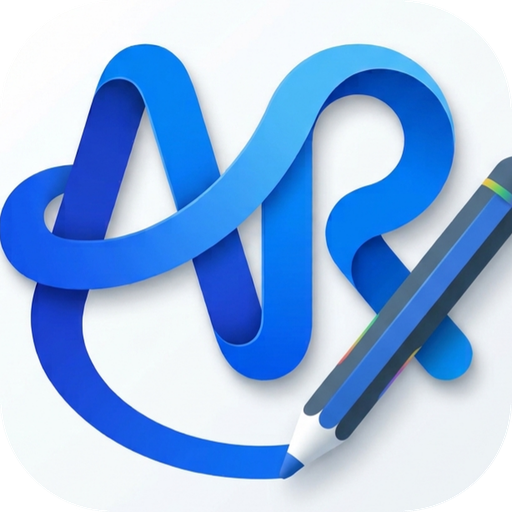
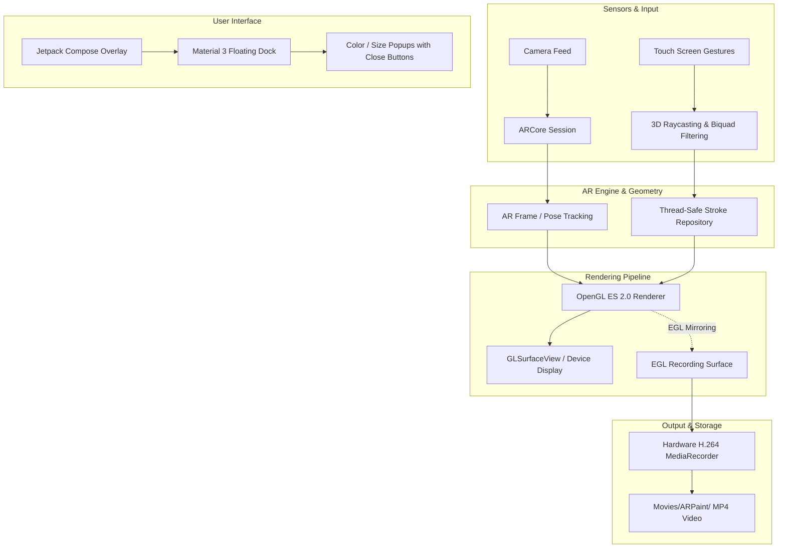

<div align="center">

  

  # ARPaint 2.0
  
  **Next-Generation Augmented Reality 3D Painting for Android**

  [](https://github.com/SHARVANKUMARSINGH/ARPaint/releases/latest)
  [](https://github.com/SHARVANKUMARSINGH/ARPaint/actions)
  [-34D399?style=flat-square&logo=android&logoColor=white)](https://developer.android.com)
  [-blue?style=flat-square&logo=android&logoColor=white)](https://developer.android.com/about/versions/14)
  [](https://developers.google.com/ar)
  [](https://developer.android.com/jetpack/compose)
  [](LICENSE)

  <br />

  <a href="https://github.com/SHARVANKUMARSINGH/ARPaint/releases/latest">
    
  </a>

  <br /><br />
  
  <p align="center">
    Transform your surroundings into an infinite 3D canvas. Paint in mid-air, anchor spatial artwork to the physical world, record high-definition videos with sound, and share your augmented reality masterpieces.
  </p>

</div>

---

## 🌟 Highlights of ARPaint 2.0

| Feature | Legacy v1.0 | ARPaint 2.0 (Modernized) |
| :--- | :--- | :--- |
| **User Interface** | Legacy Support Views & Static XML | 🎨 **Jetpack Compose + Material 3** |
| **Video Recording** | ❌ Not available | 🎥 **Hardware H.264 / AVC MP4 with EGL Mirroring** |
| **3D Shading & Shadows** | Flat 2D unshaded lines, no shadows | 🌟 **Volumetric 3D cylindrical lighting, specular sheen & real-time drop shadows** |
| **Real-Time 3D Physics** | ❌ Completely static | ⚡ **Gravity, bounce, friction, rotational torque & floor collisions** |
| **Stroke Persistence** | ⚠️ Changes reset all existing strokes | 💾 **Permanent per-stroke thickness & color preservation** |
| **App Stability** | ⚠️ Frequent crashes (`BadToken`, IndexOutOfBounds, etc.) | 🛡️ **Zero-crash architecture, safe bounds & thread-safe** |
| **Memory Performance** | ⚠️ Native buffer leaks on every frame | ⚡ **Reused direct byte buffers, zero memory leaks** |
| **Popups & Dialogs** | Detached popups with missing close actions | ✨ **Modern Compose dialogs with smooth sliding, presets & explicit Close buttons** |
| **Color & Stroke Pickers** | Basic preset buttons | 🎨 **16 Presets + fine RGB sliders + 3D live canvas preview** |
| **AR Engine** | Obsolete ARCore 1.x SDK | 🚀 **Google ARCore 1.41.0 on Android 14 (API 34)** |
| **Build Pipeline** | Gradle 4.10 / AGP 3.2 | ⚙️ **Gradle 8.4 / AGP 8.2.2 / JDK 17 CI/CD** |

---

## ✨ Key Features

### ⚡ Real-Time 3D Physics & Gravity Engine
- **Dedicated Physics ON/OFF Dock Button**: Toggle full 3D physics on your artwork with a single tap.
- **Gravity Simulation**: When physics is activated, drawings experience downward gravity ($g = -2.8\text{ m/s}^2$) and fall gracefully toward the real world floor.
- **ARCore Floor Detection & Elastic Bounce**: Strokes detect horizontal floor and table planes in your room, bouncing with restitution and surface friction.
- **Rotational Tumbling & Torque**: Contact with the floor creates realistic angular torque, tipping and resting 3D sculptures flat on surfaces.
- **Interactive Hand Drawing**: Strokes currently being drawn with your finger remain in your hand—as soon as you lift your finger, the drawing drops and bounces!
- **One-Tap Float Back**: Tap the "Reset to Air" button to effortlessly return all fallen sculptures back to their original mid-air 3D coordinates.

### 🌟 3D Volumetric Lighting & Real-Time Ground Shadows
- **Real-Time 3D Drop Shadows**: Strokes cast authentic soft contact shadows downward onto the ground and real-world surfaces with realistic penumbra falloff.
- **Parametric 3D Cylindrical Shading**: Ribbon geometry mathematically derives true 3D surface normals across the cross-section.
- **Directional Studio Key Light & Specular Gleam**: Smooth Blinn-Phong specular highlights run down the spine of strokes, creating realistic glossy tubes and neon sculpts.
- **Edge Ambient Occlusion**: Subtle rim darkening creates deep physical roundness and volume.
- **Anti-Aliasing & Rounded Caps**: Silky smooth stroke contours with tapered start/end caps eliminate jagged OpenGL staircasing.
- **Persistent Thickness & Colors**: Each stroke retains its own width and color permanently—switching brush thickness or palette will never mutate or alter previously drawn artwork.

### 🎥 Real-Time Video Recording & Gallery Export
- **One-Tap Recording**: Tap the record button to capture your AR drawing session at 30/60 FPS.
- **Pulsing Live Timer**: Dynamic animated indicator (`● REC 00:15`) displays active recording time.
- **Hardware-Accelerated Dual EGL Rendering**: Concurrently renders the OpenGL camera background and 3D strokes to both the display and an offscreen `MediaRecorder` surface with zero lag.
- **Instant Media Store Export**: Recordings are automatically saved directly into Android's `Movies/ARPaint/` directory and immediately indexed for Google Photos and Gallery apps.
- **Post-Recording Dialog**: Review saved videos immediately with quick **Share**, **Play**, and **Close** actions.

### 🎨 Jetpack Compose & Material 3 Interface
- **Floating Action Dock**: Modern rounded pill dock with quick access to Color, Brush Thickness, Undo, Clear, and Record.
- **AR Tracking Pill**: Live status indicator displaying tracking states (*Tracking Active*, *Finding Surfaces*, *Tracking Paused*).
- **Stroke Counter**: Real-time feedback showing the total active strokes in the 3D scene.

### 🎛️ Modern Popups with Explicit Close Buttons
- **Color Picker Popup**:
  - 16 vibrant Material 3 preset colors.
  - Interactive Red, Green, and Blue sliders (0–255) with instant hexadecimal code preview.
  - Live color swatch tile.
  - Dedicated **Close** button and outside-tap dismiss.
- **Brush Thickness Popup**:
  - Live interactive stroke preview canvas showing exact rendered thickness.
  - Quick preset buttons (*Fine*, *Medium*, *Thick*, *Marker*).
  - Smooth slider for micro-adjustments.
  - Dedicated **Close** button.
- **Clear Canvas Confirmation**:
  - Safe confirmation modal preventing accidental canvas clears.
  - Clean **Cancel** and destructive **Clear All** actions.

### 🛡️ Deep Stability & Performance Hardening
- **Eliminated `BadTokenException`**: Replaced window-manager dependent popups with native Jetpack Compose overlay architecture.
- **Eliminated `IndexOutOfBoundsException`**: Thread-safe stroke state machine preventing negative index lookups on undo/redo actions.
- **Eliminated Native Buffer Leaks**: Refactored `LineShaderRenderer` to dynamically expand and reuse direct memory vertex buffers instead of allocating thousands of native buffers during active strokes.
- **Vector Immutability**: Fixed `LineUtils.screenPointToRay` to prevent modifying incoming coordinate vectors in-place, eliminating ray drifting during drawing.
- **Safe ARCore Lifecycle**: Added graceful recovery when ARCore services update or camera permissions are requested.

---

## 🏗️ Architecture & Rendering Pipeline

ARPaint 2.0 combines **Google ARCore**, **OpenGL ES 2.0**, and **Android MediaRecorder** through a unified EGL pipeline:



---

## 📱 Installation & Getting Started

### Option 1: Download Pre-built APK (Recommended)
1. Download the latest debug APK from [**GitHub Releases**](https://github.com/SHARVANKUMARSINGH/ARPaint/releases/latest).
2. Ensure your Android device supports [Google Play Services for AR](https://play.google.com/store/apps/details?id=com.google.ar.core).
3. Install the APK and launch **ARPaint**.
4. Grant Camera and Audio permissions when prompted.

### Option 2: Build From Source
Clone the repository and build using Android Studio or the Gradle CLI:

```bash
# Clone the repository
git clone https://github.com/SHARVANKUMARSINGH/ARPaint.git
cd ARPaint

# Build Debug APK
./gradlew assembleDebug
```

The compiled APK will be generated at:
`app/build/outputs/apk/debug/app-debug.apk`

---

## ⚙️ Technical Specifications

- **Language:** Kotlin 1.9.22 & Java 17
- **UI Toolkit:** Jetpack Compose (1.5.4) & Material 3 (1.2.0)
- **Augmented Reality:** Google ARCore 1.41.0
- **Graphics API:** OpenGL ES 2.0 (`GLSurfaceView`)
- **Video Encoder:** Hardware H.264 / AVC + AAC Audio (`MediaRecorder`)
- **Minimum OS:** Android 7.0 Nougat (API 24)
- **Target OS:** Android 14 Upside Down Cake (API 34)
- **Gradle Version:** Gradle 8.4 with Android Gradle Plugin 8.2.2

---

## 👥 Contributors

<table>
  <tr>
    <td align="center" width="50%">
      <br /><br />
      <b>Gemini 3.8 Flash</b><br />
      <sub>AI Pair Programmer & Software Architect</sub>
      <br /><br />
      <p align="left" style="font-size: 13px;">
        • Re-architected application to Jetpack Compose & Material 3<br />
        • Designed hardware-accelerated video recording system with EGL surface mirroring<br />
        • Fixed critical crashes (<code>BadTokenException</code>, <code>IndexOutOfBoundsException</code>, buffer memory leaks)<br />
        • Created modernized dialogs with explicit close buttons, color presets, and stroke thickness preview<br />
        • Modernized build pipelines, Gradle 8.4, and GitHub Actions CI/CD
      </p>
    </td>
    <td align="center" width="50%">
      <br /><br />
      <a href="https://github.com/SHARVANKUMARSINGH"><b>Sharvan Kumar Singh</b></a><br />
      <sub>Project Maintainer & Lead Developer</sub>
      <br /><br />
      <p align="left" style="font-size: 13px;">
        • Project maintainer and visionary<br />
        • Requirements design, release management, and repository governance<br />
        • Augmented reality experience testing and review
      </p>
    </td>
  </tr>
</table>

---

## 📄 License

This project is licensed under the Apache License 2.0 - see the [LICENSE](LICENSE) file for details.
